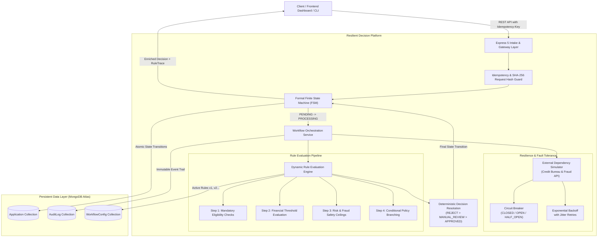
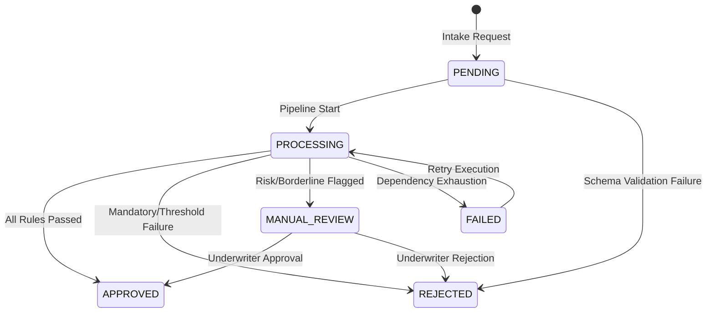

# System Architecture & Technical Design Document

## Resilient Configurable Decision Platform

---

## 1. Executive Summary & Problem Structuring (20 Marks)

Real-world business systems operate under constant ambiguity, shifting regulatory policies, and unstable third-party dependencies. Hardcoded decision trees and fragile monoliths fail when business requirements evolve or external providers suffer transient outages.

The **Resilient Decision Platform** addresses these challenges by decoupling decision rules, external enrichment, and lifecycle state management into an extensible, fault-tolerant orchestration architecture.

### Key Architectural Tenets
1. **Separation of Concerns:** Clear physical boundaries between intake validation, lifecycle state transitions, rule evaluations, and third-party integrations.
2. **Deterministic Explainability:** Every automated decision generates a transparent, human-auditable execution trace detailing the exact criteria evaluated, runtime inputs, thresholds, and triggered outcomes.
3. **Operational Resilience:** Built-in fault tolerance featuring **idempotent request handling**, **exponential backoff with jitter**, **circuit breaker pattern**, and **two-phase commit database transactions**.
4. **Zero-Downtime Configurability:** Workflows and rules are stored as versioned configuration models that can be created, updated, and activated dynamically without code deployments or server restarts.

---

## 2. High-Level System Architecture (20 Marks)



---

## 3. Core Components Breakdown

### 3.1. Intake & Idempotency Guard
* Validates schema boundaries using `express-validator`.
* Enforces mandatory `Idempotency-Key` headers (up to 128 characters).
* Computes a canonical **SHA-256 hash** of the request payload:
  * **Identical Replay:** Returns previously evaluated response immediately (`duplicate: true`, `HTTP 200 OK`).
  * **Key Conflict:** If the same key is reused with modified payload data, requests are rejected with `HTTP 409 Conflict`.
  * **Race Condition Mitigation:** Uses MongoDB unique indexes and transactional session boundaries to handle simultaneous parallel duplicate requests cleanly.

### 3.2. Finite State Machine (FSM)
Lifecycle state transitions are formally governed by `stateMachine.js`:
* **States:** `PENDING`, `PROCESSING`, `APPROVED`, `REJECTED`, `MANUAL_REVIEW`, `FAILED`.
* **Guards:** Transitions are strictly validated against a directed transition graph. Any illegal state change (e.g. `APPROVED -> PENDING` or `REJECTED -> APPROVED`) throws an `InvalidStateTransitionError`.
* **State History Audit:** Every transition immutably records `fromStatus`, `toStatus`, `reason`, `performedBy`, and high-resolution timestamp.



### 3.3. Dynamic Rule Evaluation Engine
* **Operators:** Evaluates `gte`, `gt`, `lte`, `lt`, `eq`, `neq`, `between`, `in`, `nin`, `contains`, `regex`, and `exists`.
* **Derived Metrics:** Dynamically computes runtime variables including `loanToIncomeRatio` ($\text{loanAmount} / \text{income}$), `verifiedCreditScore`, and `fraudRiskScore`.
* **Multi-Step Priorities:** Rules are ordered and executed by priority (`1..N`).
* **Explainable Output:** Every rule execution generates an auditable trace item:
  ```json
  {
    "ruleName": "Minimum Income Threshold",
    "category": "MANDATORY",
    "field": "income",
    "operator": "gte",
    "expectedValue": 20000,
    "actualValue": 15000,
    "passed": false,
    "outcome": "REJECT",
    "reason": "Minimum income requirement of 20,000 not met"
  }
  ```

### 3.4. External Dependency Simulator & Resilience Engine
Simulates mission-critical third-party integrations (Credit Bureau Inquiries, Fraud Registries):
1. **Exponential Backoff with Jitter:** On transient network drops or timeouts, retries are spaced exponentially:
   $$\text{Delay} = \text{initialDelay} \times (\text{backoffFactor})^{\text{attempt}-1} + \text{randomJitter}$$
2. **Circuit Breaker:** Tracks failure frequencies:
   * `CLOSED`: Normal operation; requests pass through.
   * `OPEN`: Consecutive errors reach threshold ($\ge 3$); fails fast immediately without hammering external systems.
   * `HALF_OPEN`: After cooldown timeout (5,000ms), allows single test probe to verify external recovery before resetting.

---

## 4. Engineering Robustness & Failure Modes (20 Marks)

| Failure Scenario | Threat / Risk | Mitigation Mechanism in Platform |
| :--- | :--- | :--- |
| **Network Partition / 503** | Upstream external bureau outage blocks thread | Exponential backoff retry (3 attempts) + Circuit Breaker fail-fast |
| **Double Submit / Network Replay** | Multiple loans created for single applicant | `Idempotency-Key` + SHA-256 payload hash validation |
| **Tampered Duplicate** | Attacker alters loan amount with cached key | SHA-256 mismatch detection triggers `HTTP 409 Conflict` |
| **Invalid State Tampering** | Manual attempt to approve a rejected loan | State Machine guard throws `InvalidStateTransitionError` |
| **Partial Save Failure** | Crashed execution leaves DB in corrupted state | Multi-document MongoDB ACID transactions (`session.withTransaction`) |
| **Cascading Latency** | Slow external APIs consume backend sockets | Circuit Breaker trips to `OPEN`, immediately returning cached recovery options |

---

## 5. Dynamic Configurability & Multiple Use Cases (15 Marks)

The platform is use-case agnostic. Rules and stages are configured via the database or REST API without altering application code.

### Example Multi-Use-Case Adaptability
1. **Loan Approval Workflow (Default):**
   * Fields: `income`, `creditScore`, `loanAmount`, `activeDefaults`.
   * Outcomes: `APPROVED`, `MANUAL_REVIEW`, `REJECTED`.
2. **Vendor Approval Workflow:**
   * Fields: `gstinVerified`, `yearsInBusiness`, `annualTurnover`, `blacklisted`.
   * Rules: `yearsInBusiness >= 2` (Mandatory), `blacklisted == false` (Reject).
3. **Claim Processing Workflow:**
   * Fields: `claimAmount`, `policyAgeDays`, `incidentReportAttached`.
   * Rules: `claimAmount <= 50000` (Auto-Approve), `policyAgeDays < 30` (Manual Review).

New workflows and updated versions can be published via `POST /api/workflows` and toggled live via `PUT /api/workflows/:id/activate`.

---

## 6. Trade-Off Analysis & Defence (5 Marks)

### Trade-Off 1: Synchronous Pipeline vs. Asynchronous Message Broker
* **Decision:** Implemented synchronous execution with async/await promise chains and HTTP webhooks for manual review.
* **Justification:** For loan approvals and retail decision platforms, instantaneous user feedback is critical. However, the system is designed with clean service abstractions (`workflowService.processApplication`) that can be plugged into background queue workers (BullMQ / RabbitMQ / Kafka) with zero architectural rewrites.

### Trade-Off 2: Embedded Rule Engine vs. External Rules Engine (e.g., Drools / Camunda)
* **Decision:** Built a lightweight, zero-dependency, JSON-driven Rule Engine in native ESM JavaScript.
* **Justification:** Avoids heavyweight JVM sidecars, eliminates latency of network hops, and keeps the deployment footprint minimal, portable, and easily testable under strict operational constraints.

### Trade-Off 3: Full Audit Log vs. Event Sourcing
* **Decision:** Dual-layer auditability: high-level state history embedded directly in `Application.stateHistory` paired with an immutable `AuditLog` collection.
* **Justification:** Avoids the operational overhead and projection complexities of full Event Sourcing, while delivering 100% auditable traceability, time-stamped events, and complete explainability.

---

## 7. Scaling Considerations for Production

1. **Horizontal Scaling:** Backend services are completely stateless; sessions are maintained in MongoDB Atlas. Instances can scale horizontally behind an NGINX or AWS ALB load balancer.
2. **Queue-Based Asynchronous Decoupling:** For high-throughput bursts ($>10,000\text{ req/sec}$), intake endpoints can publish to Apache Kafka or RabbitMQ topics, consumed by a pool of decision worker nodes.
3. **Distributed Caching (Redis):** Cache active workflow configurations in Redis with TTL and pub/sub cache invalidation on rule updates.
4. **Database Sharding:** Shard the `applications` collection on `{ useCase: 1, createdAt: -1 }` or `{ applicantId: "hashed" }` to distribute write throughput across multiple database replica sets.

